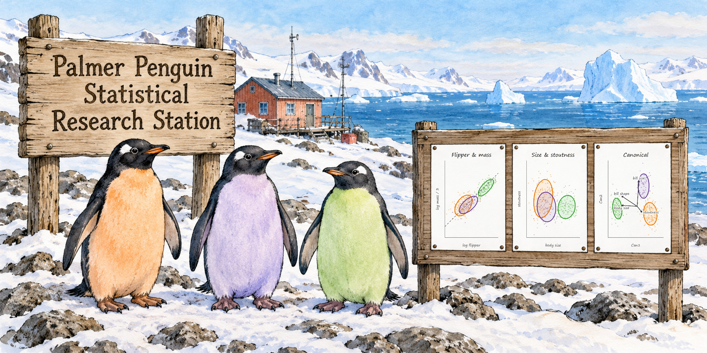

```{r setup}
#| include: false
knitr::opts_chunk$set(comment = "#>", fig.align = "center")
options(digits = 3)
```



## The question

Data analysis usually starts with the variables as they were recorded, but what is easy to *measure* is not always what is best to *think about*. A physician records height and weight, but body mass index, weight relative to height, says more about a patient. Re-expressing the measured variables as combinations with clear meanings (ratios, or sums and differences of logs, which rotate the original axes) can make plots easier to read and models easier to interpret, without changing what the data say to a multivariate model. The statistics are equivalent under such transformations,
but our understanding can be better grounded in what the variables mean.

In a first pass at this topic for the penguins data [Thinking about Penguin Variables](https://friendly.github.io/blog/posts/2026-10-peng-altviews/), it was natural to think of re-expressing
bill length ($L$) and bill depth ($D$)  bill **size** and **shape**,

$$
\log \text{Size} = \log L + \log D \qquad \log \text{Shape} = \log L - \log D \; ,
$$

a 45° rotation of the log length--depth plane. The new axes had clear meanings, the within-species variation lay almost entirely along size, the species separated along shape, and Simpson's paradox disappeared.

That post ended by noting that flipper length and body mass are also, in part, measures of overall size, and left them as "a story for another vignette." This is that follow-up (the earlier analysis is in `peng-bill-size-shape-altviews.qmd`). The other two penguin measurements are `flipper_length` ($F$) and `body_mass` ($M$). 

Is there a similar re-expression of these that makes more sense in terms of what matters to a penguin---
**allometry**: the study of how the shape, anatomy, physiology, or behavior of an organism changes in proportion to its overall body size? 
This note describes what was tried and what came of it. In the process, I discovered some questions regarding the data itself: exactly how the data was recorded and whether there were any changes over time.
The code is also in `body-flipper.R`.

 ([\@kristinHenry\@vis.social](https://vis.social/@kristinHenry)), used with permission.](../../images/KHenry-penguins.jpg){#fig-khenry width=50%}

## Putting mass and length on the same footing

For the bill, length and depth are both lengths, in mm, so their sum and difference on the log scale mean something directly. Flipper length ($F$, in mm) and body mass ($M$, in g) are not like that. (Here and throughout, $F$ and $M$ stand for **flipper length** and **body mass**, not female and male.) Mass goes with volume, and volume goes with the cube of length. A penguin that is 10% longer in every dimension, with the same proportions, is $1.1^3 = 1.33$ times as heavy.

So the first step is to turn mass into a length-like quantity, its cube root, $M^{1/3}$. On the log scale that is just $\log M / 3$. Then the same 45° rotation of $(\log F, \; \log M / 3)$ gives

$$
\begin{aligned}
\log \text{Body size} &= \log F + \tfrac{1}{3} \log M &= \log\left(F \times M^{1/3}\right) \\
\log \text{Stoutness} &= \tfrac{1}{3} \log M - \log F &= \log\left(M^{1/3} / F\right) \; .
\end{aligned}
$$

**Body size** is overall size. **Stoutness** says whether a penguin is heavy or light for its flipper length. Cubing it gives $M / F^3$: stoutness is a penguin version of the condition factor $K = W / L^3$ used for fish, or of the ponderal index for people. Stoutness has no units; for these penguins $M / F^3$ is about 0.5 g/cm³.

Because these are natural logs, small differences on either scale read as approximate proportions. A difference of 0.03 in log stoutness means that $M^{1/3} / F$ is about 3% larger; at the same flipper length, that is about 9% more mass ($1.03^3 = 1.09$). Body size needs one more step, because it is the log of a *product* of two length-like quantities. A difference of $d$ in log body size means that $F \times M^{1/3}$ is larger by a factor of $e^d$, or each of $F$ and $M^{1/3}$ by about $d/2$. Gentoo and Adelie, for example, differ by 0.24 in log body size: $F \times M^{1/3}$ is 27% larger ($e^{0.24} = 1.27$), or about 13% per linear dimension.

This re-expression comes with a prediction. If penguins scale up **isometrically**, keeping their proportions as they get bigger, then $\log M$ increases by 3 for each unit increase in $\log F$. Bigger penguins and smaller ones then differ only in size, so variation within a species lies along the body-size axis and stoutness does not depend on body size. Whether that is so is something the data can tell us.

## Data and helpers

The data are `heplots::peng` (Gorman, Williams & Fraser, 2014), the 333 complete cases of `palmerpenguins::penguins`. The bill variables from the earlier post are computed too, for comparisons later.

```{r packages}
library(dplyr)
library(tidyr)
library(ggplot2)
library(patchwork)
library(car)
library(heplots)
library(candisc)

data(peng, package = "heplots")

peng <- peng |>
  mutate(
    log_flipper = log(flipper_length),
    log_mass3   = log(body_mass) / 3,                   # log of the cube root of mass
    body_size   = log_flipper + log_mass3,
    stoutness   = log_mass3 - log_flipper,
    K           = body_mass / (flipper_length / 10)^3,  # raw stoutness, g / cm^3
    log_length  = log(bill_length),
    log_depth   = log(bill_depth),
    bill_size   = log_length + log_depth,
    bill_shape  = log_length - log_depth,
    fyear       = factor(year)
  )
```

The species colors and the plotting helpers are the ones from the earlier post. `species_labels()` now takes an optional `nudge` table to move labels that would otherwise overlap.

```{r helpers}
#| code-fold: true
#| code-summary: "Show the helpers"
peng_cols <- c(Adelie = "#F37A00", Chinstrap = "#6A3D9A", Gentoo = "#33a02c")

theme_set(theme_bw(base_size = 14))
scale_penguins <- list(
  scale_color_manual(values = peng_cols, aesthetics = c("colour", "fill"))
)

# `nudge`: optional data frame of species, dx, dy, to move labels that would overlap
species_labels <- function(x, y, data = peng, by = NULL, size = 5, nudge = NULL) {
  means <- data |>
    group_by(species, across(all_of(by))) |>
    summarise(x = mean({{ x }}), y = mean({{ y }}), .groups = "drop")
  if (!is.null(nudge))
    means <- means |>
      left_join(nudge, by = "species") |>
      mutate(x = x + coalesce(dx, 0), y = y + coalesce(dy, 0))
  geom_label(data = means, aes(x = x, y = y, label = species, color = species),
             fill = "white", alpha = 0.75, size = size, fontface = "bold",
             inherit.aes = FALSE)
}

peng_plot <- function(x, y, data = peng, pooled = TRUE, by = NULL, nudge = NULL) {
  p <- ggplot(data, aes(x = {{ x }}, y = {{ y }},
                        color = species, shape = species, fill = species)) +
    geom_point(size = 1.5, alpha = 0.6) +
    stat_ellipse(geom = "polygon", level = 0.68, alpha = 0.15) +
    stat_ellipse(geom = "polygon", level = 0.95, alpha = 0.10) +
    geom_smooth(method = "lm", formula = y ~ x, se = FALSE, linewidth = 1.5) +
    scale_penguins +
    theme(legend.position = "none")
  if (pooled)
    p <- p + geom_smooth(aes(x = {{ x }}, y = {{ y }}), inherit.aes = FALSE,
                         method = "lm", formula = y ~ x,
                         se = FALSE, color = "black", linetype = "dashed",
                         linewidth = 1)
  p + species_labels({{ x }}, {{ y }}, data = data, by = by, nudge = nudge)
}
```

## Two views of the same bodies

@fig-two-views shows flipper length and body mass as recorded (left) and as body size and stoutness (right).

```{r}
#| label: fig-two-views
#| fig-width: 10
#| fig-height: 4.5
#| fig-cap: "Left: body mass vs. flipper length. Mass increases with flipper length both within species and across them, so there is no Simpson's paradox here. Right: the same data as log stoutness vs. log size, with equal scales on the two axes. The species are spread out along size; within each species, the variation is mainly in size too."
p1 <- peng_plot(flipper_length, body_mass,
                nudge = tibble(species = c("Adelie", "Chinstrap"),
                               dx = c(-6, 7), dy = c(450, -500))) +
  labs(x = "Flipper length (mm)", y = "Body mass (g)", title = "Flipper & mass")

p2 <- peng_plot(body_size, stoutness,
                nudge = tibble(species = c("Adelie", "Chinstrap"),
                               dx = c(-0.04, 0.03), dy = c(0.07, -0.07))) +
  coord_equal(ylim = c(-2.70, -2.32)) +   # equal scales, with room so the panel isn't flat
  labs(x = "log Body size = log(F x M^(1/3))", y = "log Stoutness\n= log(M^(1/3) / F)",
       title = "Body size & stoutness (log scale)")

# match p1's aspect ratio to p2's, so patchwork doesn't squash either panel
p1 + theme(aspect.ratio = 0.7) | p2
```

Two things stand out, one different from the bill and one the same.

* **No paradox to resolve.** For the bill, the within-species and pooled relations had opposite signs. Here, mass increases with flipper length within every species and across all of them (pooled $r$ = `r cor(peng$flipper_length, peng$body_mass)`). The rotation has no dramatic reversal to undo.
* **The species differ in body size, not stoutness.** On equal scales (right panel), the three species are strung out along the body-size axis, Gentoo far to the right (about 13% larger than Adelie per linear dimension), while their stoutness overlaps almost completely (the species means are within 0.03, under 3%). To a first approximation, a Gentoo is a scaled-up Adelie.

## Does the cube law hold?

The isometric prediction is that, within a species, $\log M$ increases by 3 for each unit of $\log F$. The ordinary regression slope of $\log M$ on $\log F$ is the wrong estimate of this. Flipper length has its own measurement error and natural variation, and the regression slope is pulled toward zero by it (the same attenuation as in measurement error in a predictor). Studies of allometry instead use the **standardized major axis** (SMA) slope, $\text{sd}(\log M) / \text{sd}(\log F)$, which treats the two variables symmetrically (Warton et al., 2006). An equivalent check is the angle of the first principal component in the $(\log F, \log M / 3)$ plane, which is 45° under isometry.

```{r allometry}
allometry <- function(data)
  data |>
    summarise(n = n(),
              r     = cor(log_flipper, log_mass3),
              b_ols = coef(lm(I(3 * log_mass3) ~ log_flipper))[2],
              b_sma = 3 * sd(log_mass3) / sd(log_flipper),
              angle = {
                v <- eigen(cov(cbind(log_flipper, log_mass3)))$vectors[, 1]
                v <- v * sign(v[1])
                atan2(v[2], v[1]) * 180 / pi
              },
              .groups = "drop")

peng |> group_by(species) |> allometry() |> knitr::kable(digits = 2)
```

The SMA slopes (2.8 to 3.6) are close to 3, and the PC1 angles (42° to 56°) close to 45°. The OLS slopes, at 1.7 to 2.3, show how much attenuation there is. @fig-pc1 shows the within-species variation, with each species centered at its means.

```{r}
#| label: fig-pc1
#| code-fold: true
#| fig-width: 7
#| fig-height: 6
#| fig-cap: "Within-species variation in log flipper length and log mass / 3, each species centered at its means. Ellipses are 68% data ellipses; the thick lines are each species' first principal component axis. All three lie near the size direction (dashed)."
peng_c <- peng |>
  group_by(species) |>
  mutate(c_flipper = log_flipper - mean(log_flipper),
         c_mass3   = log_mass3   - mean(log_mass3)) |>
  ungroup()

pc1 <- peng_c |>
  group_by(species) |>
  group_modify(~ {
    e <- eigen(cov(cbind(.x$c_flipper, .x$c_mass3)))
    v <- e$vectors[, 1] * sign(e$vectors[1, 1])
    r <- 2 * sqrt(e$values[1])
    tibble(x = -r * v[1], y = -r * v[2], xend = r * v[1], yend = r * v[2],
           angle = atan2(v[2], v[1]) * 180 / pi)
  }) |>
  ungroup() |>
  mutate(label = sprintf("%s: %.0f°", species, angle),
         lab_x = 0.05, lab_y = -0.06 - 0.01 * (row_number() - 1))

ggplot(peng_c, aes(x = c_flipper, y = c_mass3, color = species, fill = species)) +
  geom_abline(slope =  1, intercept = 0, color = "gray50", linewidth = 0.7,
              linetype = "dashed") +
  geom_abline(slope = -1, intercept = 0, color = "gray50", linewidth = 0.7) +
  annotate("text", x = -0.07, y = -0.07, label = "size direction", angle = 45,
           vjust = -0.5, color = "gray30", size = 4.5) +
  annotate("text", x = -0.065, y = 0.065, label = "stoutness direction", angle = -45,
           vjust = -0.5, color = "gray30", size = 4.5) +
  geom_point(size = 1, alpha = 0.5) +
  stat_ellipse(geom = "polygon", level = 0.68, alpha = 0.05, linewidth = 1) +
  geom_segment(data = pc1, aes(x = x, y = y, xend = xend, yend = yend),
               linewidth = 1.5, inherit.aes = FALSE,
               color = peng_cols[as.character(pc1$species)]) +
  geom_label(data = pc1, aes(x = lab_x, y = lab_y, label = label, color = species),
             fill = "white", size = 4.5, fontface = "bold",
             hjust = 0, inherit.aes = FALSE) +
  annotate("text", x = 0.05, y = -0.06 + 0.01, label = "PC1 angle",
           hjust = 0, color = "gray30", size = 4.5) +
  coord_equal(xlim = c(-0.1, 0.1), ylim = c(-0.1, 0.1)) +
  scale_penguins +
  theme(legend.position = "none") +
  labs(x = "log Flipper length (centered within species)",
       y = "log Body mass / 3 (centered within species)")
```

There is a catch. Each species includes both sexes, and males are larger in every dimension. Part of the within-species "body size" axis is simply males vs. females. Within each species--sex group, the correlations are much weaker and the angles scatter more widely:

```{r allometry-sex}
peng |> group_by(species, sex) |> allometry() |> knitr::kable(digits = 2)
```

With correlations of 0.23 to 0.67, the PC1 direction is poorly determined, and several of the angles fall well below 45°. So the cube law describes the differences between the sexes and species reasonably well, but within a group of same-sex adults, flipper length and mass vary fairly independently.

## One variable at a time

How much of the variation in each variable is due to species, how much to sex, and how much is left over? @tbl-eta2 gives the proportions of the total sum of squares in a model with species and sex.

```{r}
#| label: tbl-eta2
#| tbl-cap: "Proportion of variance due to species, sex and residual, for each body variable."
eta2 <- function(v) {
  a <- anova(lm(reformulate(c("species", "sex"), v), data = peng))
  setNames(a[, "Sum Sq"] / sum(a[, "Sum Sq"]), c("species", "sex", "residual"))
}
sapply(c("log_flipper", "log_mass3", "body_size", "stoutness"), eta2) |>
  knitr::kable(digits = 3)
```

Body size carries the species differences ($\eta^2$ = 0.76), as much as flipper length alone does. Stoutness carries little of them (0.14): about 79% of its variance is individual variation. That is what one would want from a measure of **body condition**: something that varies from bird to bird, rather than from species to species.

## Sex differences

```{r}
#| label: fig-sex
#| code-fold: true
#| fig-width: 10
#| fig-height: 5
#| fig-cap: "Log body size and log stoutness by species and sex. Males are larger in every species. Only for Adelie are the males also stouter."
sex_fill <- scale_fill_discrete(labels = c(f = "Female", m = "Male"))
p3 <- ggplot(peng, aes(x = species, y = body_size, fill = sex)) +
  geom_boxplot(alpha = 0.6) +
  sex_fill +
  labs(x = NULL, y = "log Body size", title = "Body size") +
  theme(legend.position = "none")
p4 <- ggplot(peng, aes(x = species, y = stoutness, fill = sex)) +
  geom_boxplot(alpha = 0.6) +
  sex_fill +
  labs(x = NULL, y = "log Stoutness", title = "Stoutness", fill = NULL) +
  theme(legend.position = "inside",
        legend.position.inside = c(0.98, 0.02),
        legend.justification = c(1, 0),
        legend.background = element_rect(color = "gray70"))
p3 + p4
```

As for the bill, sexual dimorphism is mainly a matter of body size: males are bigger in every species (@fig-sex). The exception is Adelie, where the males are also heavier for their flipper length. That is a species $\times$ sex interaction for stoutness, which also explains why the Adelie ellipse in @fig-two-views is the tallest.

## Does stoutness vary by year?

If stoutness is body condition, it should be sensitive to how good the feeding was, and so might differ between years. The data cover three seasons, 2007 to 2009.

```{r year-models}
m0 <- lm(stoutness ~ species * sex, data = peng)
m1 <- lm(stoutness ~ species * sex + fyear, data = peng)
m2 <- lm(stoutness ~ (species + sex) * fyear + species:sex, data = peng)
anova(m0, m1, m2)
```

Adding year clearly helps ($F$ = 21, $R^2$ from `r summary(m0)$r.squared` to `r summary(m1)$r.squared`), and the year effect is the same for all species and both sexes (the interactions add nothing). Stoutness declined from 2007 to 2009. But stoutness is a ratio, so the question is which part of it changed.

```{r}
#| label: fig-year
#| code-fold: true
#| fig-width: 10
#| fig-height: 5
#| fig-cap: "Means (+/- 1 SE) of flipper length, body mass and log stoutness by year and species. Body mass did not change; flipper length increased from 2007 to 2008 in all three species, and stoutness fell as a result."
year_long <- peng |>
  select(species, fyear, flipper_length, body_mass, stoutness) |>
  pivot_longer(c(flipper_length, body_mass, stoutness), names_to = "variable") |>
  mutate(variable = factor(variable, levels = c("flipper_length", "body_mass", "stoutness"),
                           labels = c("Flipper length (mm)", "Body mass (g)", "log Stoutness")))

ggplot(year_long, aes(x = fyear, y = value, color = species, group = species)) +
  stat_summary(fun.data = mean_se, geom = "pointrange",
               position = position_dodge(width = 0.3)) +
  stat_summary(fun = mean, geom = "line", linewidth = 1,
               position = position_dodge(width = 0.3)) +
  facet_wrap(~ variable, scales = "free_y") +
  scale_penguins +
  theme(legend.position = "top") +
  labs(x = "Year", y = "Mean (+/- 1 SE)", color = NULL)
```

```{r year-components}
#| code-fold: true
year_F <- function(v) {
  a <- Anova(lm(reformulate("(species + sex) * fyear + species:sex", v), data = peng))
  unlist(a["fyear", c("F value", "Pr(>F)")])
}
sapply(c("flipper_length", "body_mass", "body_size", "stoutness"), year_F) |>
  t() |> knitr::kable(digits = c(2, 4), caption = "Year effects, from a model with species, sex and their interactions with year")
```

@fig-year gives a clear answer. **Body mass shows no year effect at all** ($F$ = 0.02). **Flipper length increased** from 2007 to 2008 in every species, by about 4 mm (Adelie), 6 mm (Chinstrap) and 3 mm (Gentoo), and then changed little. The decline in stoutness is entirely due to flipper length.

That makes it hard to read as a change in body condition, which would show up in mass. Flipper length in adult penguins should not change by several mm from one season to the next.

### A measurement artifact?

The documentation says nothing about a change. Gorman, Williams & Fraser (2014) measured the right flipper "using a ruler ±1 mm" and body mass with Pesola spring scales (±25 or ±50 g). They pool all three years for their size analyses, and mention no change in methods, instruments or people across 2007--2009. The documentation of `palmerpenguins::penguins_raw` (Horst, Hill & Gorman, 2020) defines the variables but does not discuss methods, and its `Comments` column has only notes on sampling (missing blood samples, incomplete clutches). The full methods are in the metadata of the three EDI data packages (Palmer Station Antarctica LTER & Gorman, 2020a, b, c), which I have not accessed yet.

The raw data give two clues. First, the 2007--2008 increase in flipper length appears at once in every species on every island where it was measured:

```{r flipper-island}
#| code-fold: true
pr <- palmerpenguins::penguins_raw |>
  mutate(year    = format(`Date Egg`, "%Y"),
         species = sub(" .*", "", Species),
         flipper = `Flipper Length (mm)`,
         mass    = `Body Mass (g)`)

pr |>
  group_by(species, Island, year) |>
  summarise(flipper = mean(flipper, na.rm = TRUE), .groups = "drop") |>
  pivot_wider(names_from = year, values_from = flipper) |>
  knitr::kable(digits = 1)
```

Simultaneous increases of 3 to 8 mm in adult birds of three species on three islands look more like a change in how the flippers were measured than like biology.

Second, the measurements show **digit preference**, which changed over the years. With a ruler read to the nearest mm, about 20% of values should end in 0 or 5; masses read to the nearest 25 g should end in 00 about 25% of the time.

```{r digits}
pr |>
  group_by(year) |>
  summarise(n = n(),
            flipper_0_or_5 = mean(flipper %% 5 == 0, na.rm = TRUE),
            mass_00        = mean(mass %% 100 == 0, na.rm = TRUE)) |>
  knitr::kable(digits = 2)
```

In 2007 and 2008, more than a third of the flipper lengths end in 0 or 5 (about twice the expected rate): someone was often rounding to the nearest 5 mm. Masses were often rounded to the nearest 100 g (50% and 60% end in 00). In 2009 the flipper rate is at the expected 20%, and the mass rate falls to 34%. So the measuring practice did change, but between 2008 and 2009, not between 2007 and 2008 where the jump in flipper length is. The rounding is evidence that measurement practice varied over the study, not an explanation of the jump itself.

The data could settle this if the same birds had been measured in different years. Some `Individual ID`s do appear in more than one year, but they appear to be nest-based labels that may be reused each season, so they cannot be taken to identify the same bird.

The conclusion stands: the year effect on stoutness is a flipper-length effect, and a change in measurement is the most likely reason, though not a documented one. If it is, flipper length should be adjusted for year before computing stoutness (and body size, which has a smaller year effect for the same reason).

## Body and bill

How do the two body variables relate to bill size and shape? The within-species correlations, with species (and then species and sex) removed:

```{r within-cor}
within_cor <- function(groups)
  cor(resid(lm(reformulate(groups, "cbind(bill_size, bill_shape, body_size, stoutness)"),
               data = peng)))

within_cor("species") |> knitr::kable(digits = 2)
within_cor("species * sex") |> knitr::kable(digits = 2)
```

```{r}
#| label: fig-body-bill
#| code-fold: true
#| fig-width: 10
#| fig-height: 8
#| fig-cap: "Bill size (top) and bill shape (bottom) vs. body size (left) and stoutness (right). Bill size increases with body size within each species. Bill shape is unrelated to either body variable within species; it differs only between species."
p5 <- peng_plot(body_size, bill_size)  + labs(x = "log Body size", y = "log Bill size")
p6 <- peng_plot(stoutness, bill_size)  + labs(x = "log Stoutness", y = "log Bill size")
p7 <- peng_plot(body_size, bill_shape) + labs(x = "log Body size", y = "log Bill shape")
p8 <- peng_plot(stoutness, bill_shape) + labs(x = "log Stoutness", y = "log Bill shape")
(p5 + p6) / (p7 + p8)
```

The pattern is simple (@fig-body-bill):

* **Bill size goes with body size** ($r$ = 0.70 within species, 0.38 within species and sex). Bigger penguins have bigger bills.
* **Bill shape goes with nothing.** Its within-species correlations with body size and stoutness are all near zero. Bill shape is a species trait, not something that varies with how big or how heavy a bird is. The pooled (dashed) lines suggest otherwise, but only because the species differ on both.
* **Stoutness is unrelated to the bill** once sex is taken into account. How well fed a penguin is has nothing to do with its beak.

### Four variables together

With the four re-expressed variables, the MANOVA and the canonical discriminant analysis for species give a compact summary.

```{r candisc}
mod4 <- lm(cbind(bill_size, bill_shape, body_size, stoutness) ~ species + sex, data = peng)
Anova(mod4)

cd <- candisc(mod4, term = "species")

# show structure coefficients, with the large ones (|r| > 0.5) in bold
bold_large <- function(s, cut = 0.5)
  apply(s, 2, \(r) ifelse(abs(r) > cut, sprintf("**%.2f**", r), sprintf("%.2f", r)))
bold_large(cd$structure) |> knitr::kable(align = "r")
```

```{r}
#| label: fig-candisc
#| fig-width: 8
#| fig-height: 6
#| fig-cap: "Canonical discriminant plot for species, from the four re-expressed variables. The first dimension (87%) separates Gentoo, with large bodies and long, thin bills. The second (13%) separates Chinstrap from Adelie by bill size."
plot(cd, ellipse = TRUE, col = peng_cols, var.col = "black", var.lwd = 2)
```

Each canonical dimension now has a meaning that can be named (@fig-candisc). The first, accounting for 87% of the between-species variation, is Gentoo vs. the others: big body and long, thin bill (body size and bill shape). The second is Chinstrap vs. Adelie: two species of about the same body size, the Chinstrap with the bigger bill. Stoutness contributes little to either.

### Compared with the original variables

What would the same analysis say in terms of the variables as recorded? To compare like with like, use their logs, $(\log L, \log D, \log F, \log M)$. The re-expressed variables are a nonsingular linear transformation of these, so the MANOVA tests, the canonical correlations, and the canonical scores (up to sign) are all **identical**. The only thing that changes is how each canonical dimension is described: the structure coefficients, the correlations of the variables with the canonical scores.

```{r candisc-orig}
mod4_orig <- lm(cbind(log_length, log_depth, log_flipper, log_mass) ~ species + sex,
                data = peng |> mutate(log_mass = log(body_mass)))
cd_orig <- candisc(mod4_orig, term = "species")

# same squared canonical correlations, and so the same % of between-species variation
rbind(reexpressed = cd$canrsq, original = cd_orig$canrsq,
      percent = cd$pct[1:2]) |>
  `colnames<-`(c("Can1", "Can2"))
```

The structure coefficients for the original variables:

```{r candisc-orig-structure}
#| code-fold: true
#| code-summary: "Show the code to match signs"
# The canonical scores are the same up to sign. Make the signs of the canonical
# dimensions agree, so both plots have the species in the same places.
# (ggbiplot::reflect() does this for PCA and lda objects, but not candisc.)
reflect_candisc <- function(cd, columns) {
  for (j in columns) {
    cd$scores[, paste0("Can", j)] <- -cd$scores[, paste0("Can", j)]
    for (el in c("structure", "coeffs.raw", "coeffs.std", "means"))
      cd[[el]][, j] <- -cd[[el]][, j]
  }
  cd
}
flip <- diag(cor(cd$scores[, c("Can1", "Can2")], cd_orig$scores[, c("Can1", "Can2")]))
cd_orig <- reflect_candisc(cd_orig, which(flip < 0))

bold_large(cd_orig$structure) |> knitr::kable(align = "r")
```

```{r}
#| label: fig-candisc-compare
#| fig-width: 12
#| fig-height: 6
#| fig-cap: "Canonical discriminant plots for species from the original log variables (left) and the re-expressed variables (right). The points and ellipses are identical; only the variable vectors differ. On the left, the first dimension involves all four variables; on the right, it is mainly body size and bill shape."
op <- par(mfrow = c(1, 2), mar = c(4, 4, 2, 1) + 0.1)
# same vector scale in both panels, and room for their labels
plot(cd_orig, ellipse = TRUE, col = peng_cols, var.col = "black", var.lwd = 2,
     xlim = c(-12, 12), scale = 10, var.cex = 1.4, main = "Original (log) variables")
plot(cd, ellipse = TRUE, col = peng_cols, var.col = "black", var.lwd = 2,
     xlim = c(-12, 12), scale = 10, var.cex = 1.4, main = "Size, shape & stoutness")
par(op)
```

The picture of the species is the same in both panels of @fig-candisc-compare; what differs is the story the variable vectors tell.

* **With the original variables**, the first dimension (Gentoo, on the left, vs. the others) is correlated with all four: flipper length ($-0.92$), body mass ($-0.85$) and bill length ($-0.64$) in one direction, bill depth ($0.82$) in the other. Gentoo have the longest flippers and the greatest mass, bills longer than Adelie's (about as long as Chinstrap's), but the shallowest bills. Describing this dimension needs all four variables and an explanation of why bill depth goes the other way.
* **With the re-expressed variables**, the first dimension is two things: large body size and a long, thin bill (bill shape). This also accounts for the odd sign of bill depth. Gentoo bills are no bigger than Adelie bills (mean log bill size 6.57 vs. 6.56, which is why bill size is nearly uncorrelated with Can1), but they are a different shape: long and thin, so shallow for their length. And because Gentoo are much bigger birds, their bills are actually *small for their bodies*, something the original variables do not show at all (see below).
* **The second dimension** (Chinstrap vs. Adelie) is mainly bill length in the original variables ($0.76$). In the re-expressed variables, it is mainly bill size ($0.85$), with some bill shape ($0.34$). Here the original variables are, if anything, simpler. Chinstrap and Adelie have about the same body size and the same bill depth; they differ in bill length alone. The re-expression splits that one difference in two, because a longer bill is both a bigger bill and a longer one for its depth.

The small Gentoo bill is easy to check. Within species, log bill size increases with log body size, by about 1.3 for each unit (the slopes range from 1.1 to 1.65 across species, so this is an average). Comparing the species at the same body size:

```{r bill-adjusted}
coef(lm(bill_size ~ species + body_size, data = peng))
```

At the same body size, Gentoo bills are smaller than Adelie bills by about 0.31 on the log scale: about 27% less bill area ($e^{-0.31} = 0.73$), or about 14% smaller per linear dimension. Chinstrap bills are larger by 0.19, about 10% per linear dimension.

So the re-expression does not change how the species are separated; it can't, since the canonical space is the same. What it does is let the first dimension, which carries 87% of the separation, be described by two variables with clear meanings instead of a contrast among all four. The second dimension is about equally simple either way. And describing the species in terms of size and shape led to one observation that the original variables hide: Gentoo have small bills for their size.

## What was found

* **The rotation works, but needs a cube root first.** Flipper length and body mass are in different units; on the scale of $(\log F, \log M / 3)$, a 45° rotation gives body **size** and **stoutness**, mass relative to flipper length cubed: a penguin version of the condition factor $K = W / L^3$ used for fish.
* **Penguins scale roughly isometrically**, across species and sexes: the SMA slopes of $\log M$ on $\log F$ are near 3. Within a single species and sex, the relation is weak.
* **Species differ in body size, hardly in stoutness.** Gentoo are about 13% larger than Adelie per linear dimension; the species means of stoutness differ by under 3%. Stoutness is mostly individual variation, like a body condition index; sexes differ in body size, except that Adelie males are also stouter.
* **The year effect on stoutness is a flipper-length effect**, most likely a measurement artifact rather than biology. No change in method is documented, but the jump appears in all species and islands at once, and digit preference shows that measuring practice varied between years.
* **Bill size tracks body size; bill shape tracks only species.** Within species, bigger penguins have bigger bills, but bill shape doesn't vary with body size or stoutness.
* **Same separation, simpler description.** The canonical analysis of the original (log) variables separates the species in exactly the same way; only the description changes. The first dimension (87%) is a contrast among all four original variables, but in the re-expressed variables it is just large body size and a long, thin bill. The second (Chinstrap vs. Adelie) is equally simple either way: a longer bill.
* **Gentoo have small bills for their size.** Their bills are no bigger than Adelie bills, although the birds are much bigger: at the same body size, a Gentoo bill has about 27% less area, about 14% smaller per linear dimension.

### Still to do

* Isometry is only approximate. The observed within-species SMA slope (about 3.2) could define stoutness instead of the theoretical 3, as in the scaled mass index of Peig & Green (2009).
* Check the methods in the EDI metadata (not accessed yet) for a change in flipper measurement after 2007, or ask K. Gorman. If confirmed, adjust flipper length for year before computing stoutness.

## Conclusions

Unlike penguin bills, their body measurements do not hide a statistical paradox. What the re-expression gives here is interpretation: two variables whose names seem better to say what they mean--- at least to me. It would be interesting
to hear the views of biologists about the analysis here, and the more general topic of how they decide what
are the meaningful transformations of the variables they measure into ones that more closely relate to biology.

## References {.unnumbered}

* Gorman, K. B., Williams, T. D., & Fraser, W. R. (2014). Ecological sexual dimorphism and environmental variability within a community of Antarctic penguins (genus *Pygoscelis*). *PLoS ONE*, 9(3), e90081.
* Horst, A. M., Hill, A. P., & Gorman, K. B. (2020). *palmerpenguins: Palmer Archipelago (Antarctica) penguin data*. R package version 0.1.0. <https://doi.org/10.5281/zenodo.3960218>
* Palmer Station Antarctica LTER, & Gorman, K. (2020a). Structural size measurements and isotopic signatures of foraging among adult male and female Adélie penguins (*Pygoscelis adeliae*) nesting along the Palmer Archipelago near Palmer Station, 2007--2009 ver 5. Environmental Data Initiative. <https://doi.org/10.6073/pasta/98b16d7d563f265cb52372c8ca99e60f>
* Palmer Station Antarctica LTER, & Gorman, K. (2020b). Structural size measurements and isotopic signatures of foraging among adult male and female Gentoo penguin (*Pygoscelis papua*) nesting along the Palmer Archipelago near Palmer Station, 2007--2009 ver 5. Environmental Data Initiative. <https://doi.org/10.6073/pasta/7fca67fb28d56ee2ffa3d9370ebda689>
* Palmer Station Antarctica LTER, & Gorman, K. (2020c). Structural size measurements and isotopic signatures of foraging among adult male and female Chinstrap penguin (*Pygoscelis antarcticus*) nesting along the Palmer Archipelago near Palmer Station, 2007--2009 ver 6. Environmental Data Initiative. <https://doi.org/10.6073/pasta/c14dfcfada8ea13a17536e73eb6fbe9e>
* Peig, J., & Green, A. J. (2009). New perspectives for estimating body condition from mass/length data: the scaled mass index as an alternative method. *Oikos*, 118(12), 1883--1891.
* Warton, D. I., Wright, I. J., Falster, D. S., & Westoby, M. (2006). Bivariate line-fitting methods for allometry. *Biological Reviews*, 81(2), 259--291.
