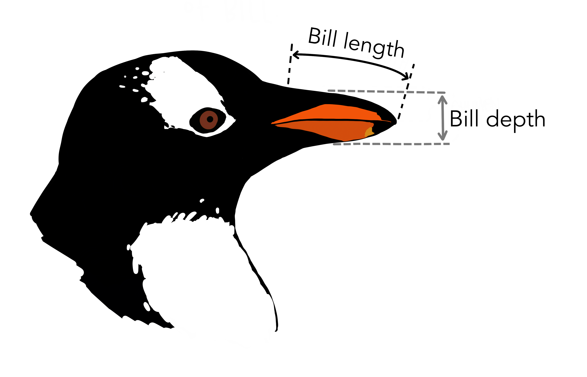

```{r setup}
#| include: false
knitr::opts_chunk$set(comment = "#>", fig.align = "center")
options(digits = 4)
```

## Variables we record vs. variables we mean

Data analysis usually starts with the variables as they were recorded. But the way a variable was *measured* is not necessarily the way it is best *thought about*:

* A researcher records height and weight because those are easy to measure. But a physician may care more about body mass index, an expression of weight relative to height. 
* A chemist records concentrations of compounds, but the meaningful quantities may be their ratios. 
* Two raters assess a collection of patients on several measures of outcome in therapy, but our main interest might be in how these agree or disagree.

The Palmer penguins data (Gorman, Williams & Fraser, 2014)
have recently become a familiar example in multivariate analysis. Penguins of three species
on islands near Palmer Station in Antarctica were measured on four aspects of their bodies. 
Two of the variables, `bill_length` and `bill_depth`, describe the penguin's bill (technically, the *culmen*, the upper ridge of the bill): its length from the base to the tip, and its depth, top to bottom, at the base (@fig-culmen). Plotted against each other, they produce one of the best known examples of Simpson's paradox: within each species, longer bills are deeper, but across the species, the relation is negative. But maybe, there's a simple re-framing of the variables variables _recorded_ into ones
better _thought about_, that makes Simpson disappear.

{#fig-culmen width=50%}

This vignette asks a simple question: **what do these two measurements really represent for penguins?** Length and depth are not biologically two separate traits of a bill; together they describe one object: its' **beak**. Two natural questions about any such object are:

* How *big* is it? --- its **size**
* What *proportions* does it have? --- its **shape**: is it long and slender, or short and stubby?

This suggests replacing (length, depth) with:

$$
\text{Size} = L \times D \qquad \text{Shape} = L / D \; ,
$$

or, more conveniently, their logarithms which are additive rather than multiplicative:

$$
\begin{aligned}
\log \text{Size}  &= \log L + \log D \\
\log \text{Shape} &= \log L - \log D \; .
\end{aligned}
$$

The **units matter** here: Size is (proportional to) the area of the bill's profile, is in mm^2^; but shape is a **dimensionless** ratio, about 2 for a bill twice as long as it is deep. That's easy to think about!

The size and shape idea goes back to the early days of multivariate morphometrics (Jolicoeur & Mosimann, 1960; Mosimann, 1970), where the first principal component of log measurements was often interpreted as "size" and the remaining ones as "shape". Here we take a simpler, more direct route, defining size and shape from what the variables _mean_, and then asking whether the data agree in these two different representations. 

### An equivalent, not a different, model

In matrix terms, the log size--shape variables are a linear transformation of the log length--depth variables,

$$
\begin{pmatrix} \log \text{Size} \\ \log \text{Shape} \end{pmatrix}
=
\begin{pmatrix} 1 & \phantom{-}1 \\ 1 & -1 \end{pmatrix}
\begin{pmatrix} \log L \\ \log D \end{pmatrix}
= \mathbf{T} \begin{pmatrix} \log L \\ \log D \end{pmatrix} \; .
$$

The columns of $\mathbf{T}$ are orthogonal and of equal length ($\sqrt{2}$), so $\mathbf{T}$ is just a **rotation** by 45° (and a rescaling by $\sqrt{2}$). Nothing about the data has changed; we are simply looking at the same point cloud from a different angle. Consequently:

* Every **multivariate** test (MANOVA, Hotelling's $T^2$, canonical discriminant analysis) gives *identical* results in the two coordinate systems, because these are invariant under nonsingular linear transformations of the responses.
* **Univariate** analyses, and **plots**, are not invariant. They depend on which directions we choose as our axes.

The payoff, if there is one, is in interpretation: in the right coordinates, the story may be simpler.

## Data and setup

The data used here is `heplots::peng` (Gorman, Williams & Fraser, 2014), a cleaned version of `palmerpenguins::penguins` with the 333 complete cases and shorter variable names.

```{r packages}
library(dplyr)
library(tidyr)
library(ggplot2)
library(patchwork)
library(car)
library(heplots)

data(peng, package = "heplots")

peng <- peng |>
  mutate(
    size       = bill_length * bill_depth,
    shape      = bill_length / bill_depth,
    log_length = log(bill_length),
    log_depth  = log(bill_depth),
    log_size   = log_length + log_depth,
    log_shape  = log_length - log_depth,
    log_mass   = log(body_mass)
  )
```

Throughout, the species are shown in the colors of Allison Horst's penguin artwork: orange for Adelie, purple for Chinstrap, green for Gentoo.

```{r colors}
peng_cols <- c(Adelie = "#F37A00", Chinstrap = "#6A3D9A", Gentoo = "#33a02c")

theme_set(theme_bw(base_size = 14))
scale_penguins <- list(
  scale_color_manual(values = peng_cols, aesthetics = c("colour", "fill"))
)
```

Rather than legends, the plots label the species directly. Two small helpers do the work: `species_labels()` places a label at each species' mean, and `peng_plot()` draws a scatterplot with points, 68% and 95% data ellipses, the within-species regression lines and (optionally) the dashed regression line for all penguins pooled, ignoring species.

```{r helpers}
species_labels <- function(x, y, data = peng, by = NULL, size = 5) {
  means <- data |>
    group_by(species, across(all_of(by))) |>
    summarise(x = mean({{ x }}), y = mean({{ y }}), .groups = "drop")
  geom_label(data = means, aes(x = x, y = y, label = species, color = species),
             fill = "white", alpha = 0.75, size = size, fontface = "bold",
             inherit.aes = FALSE)
}

peng_plot <- function(x, y, data = peng, pooled = TRUE, by = NULL) {
  p <- ggplot(data, aes(x = {{ x }}, y = {{ y }},
                        color = species, shape = species, fill = species)) +
    geom_point(size = 1.5, alpha = 0.6) +
    stat_ellipse(geom = "polygon", level = 0.68, alpha = 0.15) +
    stat_ellipse(geom = "polygon", level = 0.95, alpha = 0.10) +
    geom_smooth(method = "lm", formula = y ~ x, se = FALSE, linewidth = 1.5) +
    scale_penguins +
    theme(legend.position = "none")
  if (pooled)
    p <- p + geom_smooth(aes(x = {{ x }}, y = {{ y }}), inherit.aes = FALSE,
                         method = "lm", formula = y ~ x,
                         se = FALSE, color = "black", linetype = "dashed",
                         linewidth = 1)
  p + species_labels({{ x }}, {{ y }}, data = data, by = by)
}
```

## Two views of the same beaks

@fig-two-views shows the familiar view on the left and the size--shape view on the right.

```{r}
#| label: fig-two-views
#| fig-width: 10
#| fig-height: 5
#| fig-cap: "Left: bill depth vs. bill length, showing Simpson's paradox: positive slopes within species, a negative slope (dashed) overall. Right: the same data as log shape vs. log size. The species now differ mainly in the vertical direction, and size and shape are nearly unrelated within each species."
p1 <- peng_plot(bill_length, bill_depth) +
  labs(x = "Bill length (mm)", y = "Bill depth (mm)", title = "Length & depth")

p2 <- peng_plot(log_size, log_shape) +
  labs(x = "log Size = log(L x D)", y = "log Shape = log(L / D)",
       title = "Size & shape")

p1 + p2
```

Several things change in the size--shape view:

* **The paradox disappears.** The within-species regression lines are nearly flat and the pooled line is nearly flat too. There is no longer a conflict between the within-group and between-group relations to explain.
* **The ellipses are nearly circular** and their axes are roughly parallel to the coordinate axes. Within a species, size and shape vary nearly independently.
* **The species separate along one axis.** Shape alone distinguishes all three species: Adelie have the stubbiest bills, Gentoo the most slender, with Chinstrap in between. Size adds a second, smaller distinction: Chinstrap bills are larger than those of the other two.

The species means tell the same story in natural units. A Gentoo bill is, on average, over three times as long as it is deep; an Adelie bill only about twice.

```{r means}
peng |>
  group_by(species) |>
  summarise(n = n(),
            length = mean(bill_length), depth = mean(bill_depth),
            size = mean(size), shape = mean(shape))
```

## Seeing the rotation

Because the size--shape coordinates are a 45$^o$ rotation of the log length--depth coordinates, we can draw them directly on a plot of the logs. In @fig-rotation the solid gray lines connect bills of the same size $(\log L + \log D = \text{constant})$ and the dashed lines connect bills of the same shape $(\log L - \log D = \text{constant})$. The lines are drawn at round values of $L \times D$ (in steps of 100 mm^2^) and of $L / D$ (in steps of 0.5), a few of which are labeled. With an aspect ratio of 1, the two sets of lines meet at right angles.

```{r}
#| label: fig-rotation
#| fig-width: 7
#| fig-height: 6
#| fig-cap: "Log bill depth vs. log bill length, with lines of constant size (solid gray, slope -1) and constant shape (dashed, slope +1). The within-species ellipses are elongated along the size direction; the species are separated along the shape direction."
iso_size  <- tibble(size  = seq(400, 1200, by = 100), k = log(size))
iso_shape <- tibble(shape = seq(1.5, 4, by = 0.5),   k = log(shape))

# label a couple of lines of each kind, in empty space
lab_size  <- iso_size  |> filter(size %in% c(800, 1000)) |>
  mutate(y = 3.06, x = k - y, label = paste0("L x D = ", size))
lab_shape <- iso_shape |> filter(shape %in% c(2.5, 3)) |>
  mutate(y = c(2.60, 2.55), x = k + y, label = paste0("L / D = ", shape))

peng_plot(log_length, log_depth, pooled = FALSE) +
  geom_abline(data = iso_size, aes(intercept = k, slope = -1),
              color = "gray50", linewidth = 0.7) +
  geom_abline(data = iso_shape, aes(intercept = -k, slope = 1),
              color = "gray50", linewidth = 0.7, linetype = "dashed") +
  geom_label(data = lab_size, aes(x = x, y = y, label = label), angle = -45,
             size = 3.5, color = "gray30", fill = "white", linewidth = 0,
             inherit.aes = FALSE) +
  geom_label(data = lab_shape, aes(x = x, y = y, label = label), angle = 45,
             size = 3.5, color = "gray30", fill = "white", linewidth = 0,
             inherit.aes = FALSE) +
  coord_equal(xlim = c(3.44, 4.12), ylim = c(2.50, 3.10), expand = FALSE) +
  labs(x = "log Bill length", y = "log Bill depth")
```

Read this way, the Simpson's paradox in the original plot has a simple explanation. *Within* a species, bills vary mostly in size: big birds have bills that are both longer and deeper, so the within-species slopes are positive. *Between* species, the main difference is in shape: going from Adelie to Gentoo, bills get longer but shallower, so the between-species relation is negative.

## Do the data agree?

I chose size and shape on _substantive_ grounds, not from the _data_. Two quick checks show the choice is well supported, in that there is a natural translation of statistical ideas from (L, D) space to (Size, Shape) space.

**Within-species correlations.** If size and shape are natural dimensions for variation within a species, they should be close to uncorrelated there.

```{r correlations}
within_r <- function(x, y)
  peng |>
    group_by(species) |>
    summarise(r = cor({{ x }}, {{ y }})) |>
    bind_rows(tibble(species = "(pooled)",
                     r = cor(pull(peng, {{ x }}), pull(peng, {{ y }}))))

full_join(within_r(bill_length, bill_depth) |> rename(r_length_depth = r),
          within_r(log_size, log_shape)     |> rename(r_size_shape = r),
          by = "species")
```

The within-species correlations of length and depth are moderate to large, and differ in sign from the pooled correlation. Those of size and shape are all near zero.

**Within-species principal components.** The first principal component of the within-species covariance matrix of (log L, log D) is the direction of greatest variation within a species. If this is "size", it should point at 45°, along the vector $(1, 1)/\sqrt{2}$.

```{r pca}
peng |>
  group_by(species) |>
  group_modify(~ {
    e <- eigen(cov(cbind(.x$log_length, .x$log_depth)))
    v <- e$vectors[, 1] * sign(e$vectors[1, 1])
    tibble(PC1_length = v[1], PC1_depth = v[2],
           pct_var = 100 * e$values[1] / sum(e$values),
           angle   = atan2(v[2], v[1]) * 180 / pi)
  })
```

For each species the first component lies within a few degrees of 45° and accounts for 70--83% of the within-species variance. The dominant direction of variation within each species is, almost exactly, size.

@fig-pc1 shows this directly. Each species has been shifted to its own means, which removes the differences *between* species (mostly in shape) and leaves only the variation *within* species. Each species' first principal component axis is drawn through the origin, ±2 standard deviations long, against the size direction (slope +1, dashed, as in @fig-rotation) and the perpendicular shape direction (slope −1, solid).

```{r}
#| label: fig-pc1
#| fig-width: 7
#| fig-height: 6
#| fig-cap: "Within-species variation in log bill length and depth, with each species centered at its means. Ellipses are 68% data ellipses; the thick lines are each species' first principal component axis. All three lie close to the size direction (dashed). The Adelie ellipse is the least elongated, so its first component is less dominant."
peng_c <- peng |>
  group_by(species) |>
  mutate(c_length = log_length - mean(log_length),
         c_depth  = log_depth  - mean(log_depth)) |>
  ungroup()

pc1 <- peng_c |>
  group_by(species) |>
  group_modify(~ {
    e <- eigen(cov(cbind(.x$c_length, .x$c_depth)))
    v <- e$vectors[, 1] * sign(e$vectors[1, 1])
    r <- 2 * sqrt(e$values[1])
    tibble(x = -r * v[1], y = -r * v[2], xend = r * v[1], yend = r * v[2],
           angle = atan2(v[2], v[1]) * 180 / pi)
  }) |>
  ungroup() |>
  mutate(label = sprintf("%s: %.0f°", species, angle),
         # the PC1 axes nearly coincide, so stack their labels on the right
         lab_x = 0.15, lab_y = -0.04 - 0.035 * (row_number() - 1))

ggplot(peng_c, aes(x = c_length, y = c_depth, color = species, fill = species)) +
  geom_abline(slope =  1, intercept = 0, color = "gray50", linewidth = 0.7,
              linetype = "dashed") +
  geom_abline(slope = -1, intercept = 0, color = "gray50", linewidth = 0.7) +
  annotate("text", x = -0.15, y = -0.15, label = "size direction", angle = 45,
           vjust = -0.5, color = "gray30", size = 4.5) +
  annotate("text", x = -0.13, y = 0.13, label = "shape direction", angle = -45,
           vjust = -0.5, color = "gray30", size = 4.5) +
  geom_point(size = 1, alpha = 0.5) +
  stat_ellipse(geom = "polygon", level = 0.68, alpha = 0.05, linewidth = 1) +
  geom_segment(data = pc1, aes(x = x, y = y, xend = xend, yend = yend),
               linewidth = 1.5, inherit.aes = FALSE,
               color = peng_cols[as.character(pc1$species)]) +
  geom_label(data = pc1, aes(x = lab_x, y = lab_y, label = label, color = species),
             fill = "white", size = 4.5, fontface = "bold",
             hjust = 0, inherit.aes = FALSE) +
  annotate("text", x = 0.15, y = -0.04 + 0.035, label = "PC1 angle",
           hjust = 0, color = "gray30", size = 4.5) +
  coord_equal(xlim = c(-0.2, 0.25), ylim = c(-0.2, 0.2)) +
  scale_penguins +
  theme(legend.position = "none") +
  labs(x = "log Bill length (centered within species)",
       y = "log Bill depth (centered within species)")
```

Two features of the plot carry the argument. First, the three first component axes very nearly coincide with each other and with the size diagonal: the species share a common pattern of within-species variation, and that pattern is variation in size. Second, the ellipses are elongated along this diagonal and shorter across it: within a species, penguins differ much more in how big their bills are than in their proportions. The Adelie ellipse is the roundest of the three, which matches its smaller share of variance on the first component (70%, against about 83% for the other two).

This is also why the size and shape coordinates make the within-species correlations vanish. Rotating the coordinate axes to lie (nearly) along the long and short axes of these ellipses is what makes the two new variables nearly uncorrelated.

## One variable at a time

A multivariate view is not always on authors' minds. Some readers of a paper, on multivariate data like the
penguins, may only be shown tables or plots for one variable at a time. Here the size--shape representation does even better, because it concentrates the species differences in a single variable (@fig-densities).

```{r}
#| label: fig-densities
#| fig-width: 10
#| fig-height: 4
#| fig-cap: "Densities of the four bill variables by species. Neither bill length nor bill depth separates all three species; log shape does, with little overlap."
peng_long <- peng |>
  select(species, bill_length, bill_depth, log_size, log_shape) |>
  pivot_longer(-species, names_to = "variable") |>
  mutate(variable = factor(variable,
                           levels = c("bill_length", "bill_depth", "log_size", "log_shape")))

dens_peaks <- peng_long |>
  group_by(variable, species) |>
  summarise(d = list(density(value)), .groups = "drop") |>
  mutate(x = sapply(d, \(d) d$x[which.max(d$y)]),
         y = sapply(d, \(d) max(d$y)))

ggplot(peng_long, aes(x = value, fill = species, color = species)) +
  geom_density(alpha = 0.4) +
  geom_label(data = dens_peaks, aes(x = x, y = y, label = species, color = species),
             fill = "white", alpha = 0.75, size = 3.5, fontface = "bold",
             vjust = 0, inherit.aes = FALSE) +
  facet_wrap(~ variable, scales = "free", nrow = 1) +
  scale_y_continuous(expand = expansion(mult = c(0.02, 0.15))) +
  scale_penguins +
  labs(x = NULL, y = "Density") +
  theme(legend.position = "none")
```

The proportion of variance accounted for by species, $\eta^2$, in a one-way ANOVA of each variable puts numbers on this:

```{r eta2}
eta2 <- function(v) {
  a <- anova(lm(reformulate("species", v), data = peng))
  a[1, "Sum Sq"] / sum(a[, "Sum Sq"])
}
sapply(c("bill_length", "bill_depth", "log_size", "log_shape"), eta2)
```

Shape accounts for nearly 90% of the variance; neither length nor depth reaches 75%.

## Sex differences: bigger, not different

Male penguins are larger than females. Does this extend to the shape of their bills? @fig-sex suggests not.

```{r}
#| label: fig-sex
#| fig-width: 10
#| fig-height: 5
#| fig-cap: "Log size and log shape by species, separately for females and males. The configuration of the species is the same in both panels, but shifted to the right for males: males have larger bills of the same shape."
peng_plot(log_size, log_shape, pooled = FALSE, by = "sex") +
  facet_wrap(~ sex, labeller = as_labeller(c(f = "Female", m = "Male"))) +
  labs(x = "log Size", y = "log Shape")
```

A two-way MANOVA model confirms this. As promised, the multivariate tests are the same whichever pair of variables we use:

```{r manova}
mod_LD <- lm(cbind(log_length, log_depth) ~ species + sex, data = peng)
mod_SS <- lm(cbind(log_size, log_shape)   ~ species + sex, data = peng)

Anova(mod_LD)
Anova(mod_SS)
```

But the univariate tests now separate the two effects cleanly. Species differ strongly in both size and shape; the sexes differ strongly in size and not at all in shape.

```{r univariate}
summary(aov(mod_SS))
```

In the original variables, the sex effect is spread over both length and depth, and the reader has to work out that the two increases are in proportion.

## HE plots

Hypothesis--error (HE) plots show these models directly. In each panel of @fig-heplots, the **E** ellipse shows the within-group (residual) covariance, and the **H** ellipses show the variation of the species means and the sex means, scaled here so that their size is comparable to the error ellipse (`size = "effect"`).

```{r}
#| label: fig-heplots
#| fig-width: 10
#| fig-height: 5
#| fig-cap: "HE plots for the MANOVA of bill measures on species and sex. Left: log length and log depth. Right: log size and log shape. The two plots are the same picture rotated by 45 degrees. In the right panel, the sex effect is a horizontal line (size only) and the error ellipse is aligned with the axes."
op <- par(mfrow = c(1, 2), mar = c(4, 4, 1, 1) + 0.1)
heplot(mod_LD, size = "effect", fill = TRUE, fill.alpha = 0.1, asp = 1,
       xlab = "log Bill length", ylab = "log Bill depth")
heplot(mod_SS, size = "effect", fill = TRUE, fill.alpha = 0.1, asp = 1,
       xlab = "log Size", ylab = "log Shape")
par(op)
```

In the size--shape version:

* The **error ellipse** has its axes parallel to the coordinate axes: residual size and shape are uncorrelated.
* The **sex effect** degenerates to a line (one degree of freedom) that is almost exactly horizontal: a pure size difference.
* The **species** ellipse is tall and narrow: species differ mostly in shape, with Chinstrap displaced to the right by its larger bills.

The within-species data ellipses (@fig-covellipses) show the same alignment, with the pooled within-group ellipse in black.

```{r}
#| label: fig-covellipses
#| fig-width: 10
#| fig-height: 5
#| fig-cap: "Within-species 68% data ellipses and the pooled within-group ellipse (black), in log length--depth coordinates (left) and log size--shape coordinates (right)."
op <- par(mfrow = c(1, 2), mar = c(4, 4, 1, 1) + 0.1)
cols <- c(peng_cols, "black")
covEllipses(cbind(log_length, log_depth) ~ species, data = peng,
            pooled = TRUE, fill = TRUE, fill.alpha = 0.1, col = cols,
            xlab = "log Bill length", ylab = "log Bill depth", asp = 1)
covEllipses(cbind(log_size, log_shape) ~ species, data = peng,
            pooled = TRUE, fill = TRUE, fill.alpha = 0.1, col = cols,
            xlab = "log Size", ylab = "log Shape", asp = 1)
par(op)
```

## Size, shape, and body mass

Thinking of bill size as an *area* suggests one more question. If bills simply scaled with the rest of the body (isometric growth), bill area would grow as body mass to the 2/3 power, since mass is proportional to volume. On log scales, this means a slope of 2/3 for log size on log mass, and a slope of 0 for log shape (@fig-allometry).

```{r}
#| label: fig-allometry
#| fig-width: 10
#| fig-height: 5
#| fig-cap: "Bill size (left) and bill shape (right) vs. body mass, on log scales. Bill size increases with body mass within each species; bill shape does not depend on body mass within any species, although the pooled line (dashed) suggests that it does."
p3 <- peng_plot(log_mass, log_size) +
  labs(x = "log Body mass", y = "log Bill size")
p4 <- peng_plot(log_mass, log_shape) +
  labs(x = "log Body mass", y = "log Bill shape")
p3 + p4
```

The within-species slopes are:

```{r slopes}
slopes <- function(y) {
  b <- coef(lm(reformulate("species / log_mass - 1", y), data = peng))
  b[grep(":log_mass", names(b))]
}
rbind(log_size = slopes("log_size"), log_shape = slopes("log_shape")) |>
  `colnames<-`(levels(peng$species))
```

Shape is unrelated to body mass within all three species. The positive pooled slope in the right panel is another between-species effect, not a within-species one: Gentoo are both the heaviest penguins and the ones with the most slender bills. The size slopes for Adelie and Chinstrap are close to the isometric value of 2/3; Gentoo bills grow faster than isometry would predict. These are rough, descriptive slopes (mass and bill measures both contain measurement error, so ordinary least squares slopes are attenuated), but they illustrate that thinking about *what a variable measures* can suggest a baseline to compare against, here the value 2/3, that the raw variables would not.

## Sums and differences: the Tukey trick

Here's a trick I learned from John Tukey. When two variables $x_1$ and $x_2$ are *commensurable*, measured in the same units and on comparable scales, and are positively correlated, you can always replace them by their sum (or mean) and their difference without losing information, and often with _a gain in interpretability_:

$$
s = x_1 + x_2 \qquad d = x_1 - x_2 \; .
$$

This is the same 45° rotation used above for size and shape. As a graphical method, the plot of the difference $d$ against the mean $s/2$ is known as the **Tukey mean-difference plot** (Cleveland, 1993, pp. 22--23). In medicine, where it is the standard way to compare two methods of measuring the same quantity, it is called the **Bland--Altman plot** (Bland & Altman, 1986); see the [Wikipedia article](https://en.wikipedia.org/wiki/Bland%E2%80%93Altman_plot) for a description and variants. 

As we did for the penguins, that article recommends taking logs first when the two measurements differ by a _ratio_ rather than an _amount_. Stated more directly, the diagram of penguin bills (@fig-culmen), suggested that
the product, $L \times D = \text{area}$ was a natural measure of bill **size**, while the ratio $L / D$ could be
interpreted as **shape**.


Two things make the Tukey trick work:

* First, the new variables are nearly uncorrelated. The covariance of the sum and the difference is

$$
\text{Cov}(s, d) = \text{Var}(x_1) - \text{Var}(x_2) \; ,
$$

whatever the correlation between $x_1$ and $x_2$. When the two variables have about the same variance, $s$ and $d$ are almost uncorrelated, *no matter how strongly $x_1$ and $x_2$ are correlated*. If both have variance $\sigma^2$, the variances of the sum and difference are $2\sigma^2 (1 + r)$ and $2\sigma^2 (1 - r)$, which shows where the variation went: the larger the correlation $r$, the more of it is carried by the sum and the less by the difference.

* Second, sums and differences usually *mean* something. The sum (or average) is the overall level or amount the two variables share; the difference is the contrast between them. For the penguins, these are size and shape. For two test scores, they are overall ability and a profile difference; for two measurement methods, they are the average reading and the disagreement between methods.

"Commensurable" is doing real work here. On the raw scale, bill length has two to three times the standard deviation of bill depth, so their sum and difference would still be correlated. On the log scale, each standard deviation is roughly a *coefficient of variation*, a relative spread, and these are nearly equal:

```{r sd-logs}
peng |>
  group_by(species) |>
  summarise(sd_length     = sd(bill_length),
            sd_depth      = sd(bill_depth),
            sd_log_length = sd(log_length),
            sd_log_depth  = sd(log_depth),
            r_size_shape  = cor(log_size, log_shape))
```

Taking logs is what makes length and depth commensurable, and that, in turn, is why log size and log shape are so nearly uncorrelated within each species.

The same trick is a simple cure for **collinearity** among predictors in a regression. If $x_1$ and $x_2$ are highly correlated, their separate coefficients are poorly determined; replacing them by $s$ and $d$ gives nearly uncorrelated predictors and an equivalent model. The coefficients are just re-expressed, as the average and the half-difference of the original ones:

$$
b_s = (b_1 + b_2) / 2 \qquad b_d = (b_1 - b_2) / 2 \; .
$$

For example, predicting log body mass from the log bill measurements (and species):

```{r collinearity}
m_LD <- lm(log_mass ~ species + log_length + log_depth, data = peng)
m_SS <- lm(log_mass ~ species + log_size   + log_shape, data = peng)
b <- coef(m_LD)[c("log_length", "log_depth")]
cbind(from_LD = c(log_size  = mean(b), log_shape = unname(-diff(b)) / 2),
      m_SS    = coef(m_SS)[c("log_size", "log_shape")])
```

This doesn't create information that wasn't in the data. When $r$ is large, the difference has little variance, and its coefficient is still estimated imprecisely. What the rotation does is put that imprecision where it belongs, in one interpretable contrast, rather than spreading it over both of the original coefficients.

## Lessons

* **Look at what the variables mean before you analyze them.** Length and depth are two measurements of one object. Re-expressing them as size and shape is a choice made on substantive grounds, not by fitting the data.

* **Equivalent models can tell different stories.** Because the transformation is linear (in the logs) and nonsingular, nothing in the multivariate model changes: the fitted values, residuals and tests are the same. What changes is which questions are easy to answer and which plots are easy to read.

* **A good re-expression simplifies.** In the size--shape coordinates, within-species variation is nearly uncorrelated, species differences are concentrated in one variable, the sex effect is confined to the other, and Simpson's paradox goes away.

* **Check the choice against the data.** Here the within-species principal components point almost exactly in the size direction, so the substantive choice and the empirical one agree.

* **Sums and differences are a general tool.** For positively correlated, commensurable variables, rotating to their sum and difference gives nearly uncorrelated variables that are usually easier to interpret, and is a simple remedy for collinearity.

The same reasoning applies to the other penguin variables. Flipper length and body mass are also, in part, measures of overall size; one might go on to define an overall body size (for example, the mean of the four log measurements) and express each variable relative to it. That is a story for another vignette.

## References {.unnumbered}

* Bland, J. M., & Altman, D. G. (1986). Statistical methods for assessing agreement between two methods of clinical measurement. *The Lancet*, 327(8476), 307--310. https://doi.org/10.1016/S0140-6736(86)90837-8
* Cleveland, W. S. (1993). *Visualizing Data*. Hobart Press. pp. 22–23. ISBN 978-0-9634884-0-4.
* Gorman, K. B., Williams, T. D., & Fraser, W. R. (2014). Ecological sexual dimorphism and environmental variability within a community of Antarctic penguins (genus *Pygoscelis*). *PLoS ONE*, 9(3), e90081.
* Jolicoeur, P., & Mosimann, J. E. (1960). Size and shape variation in the painted turtle. A principal component analysis. *Growth*, 24, 339--354.
* Mosimann, J. E. (1970). Size allometry: Size and shape variables with characterizations of the lognormal and generalized gamma distributions. *Journal of the American Statistical Association*, 65(330), 930--945.
